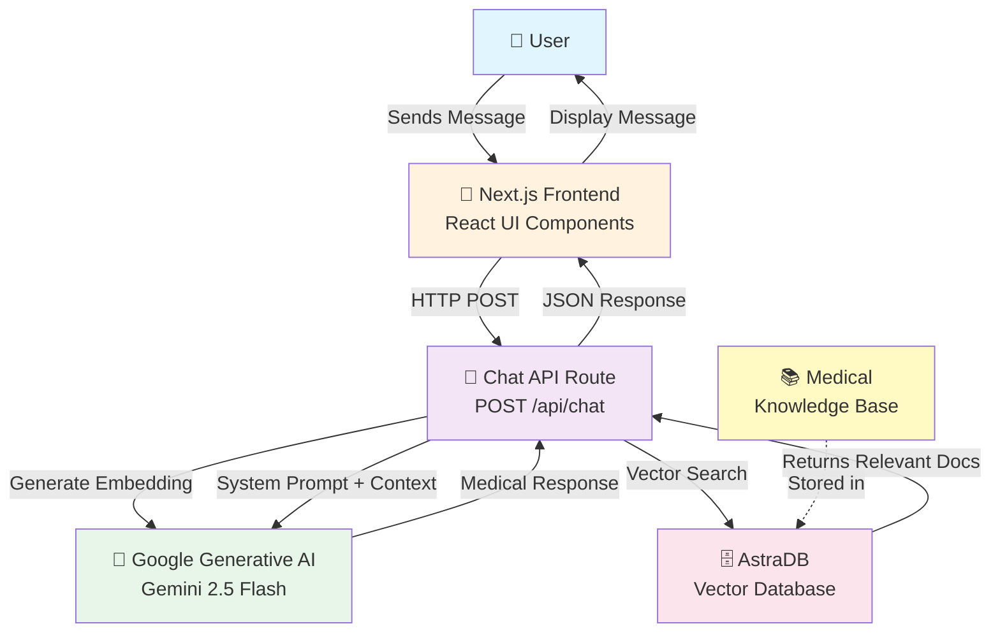
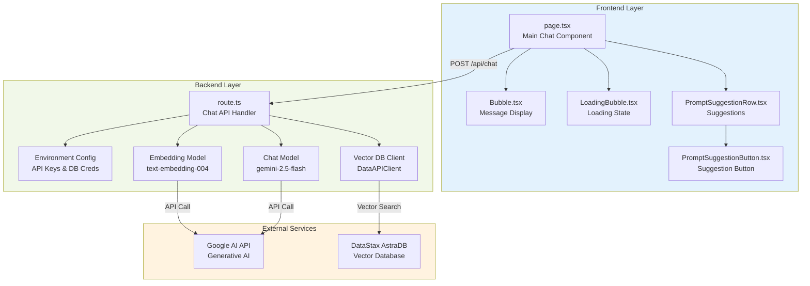
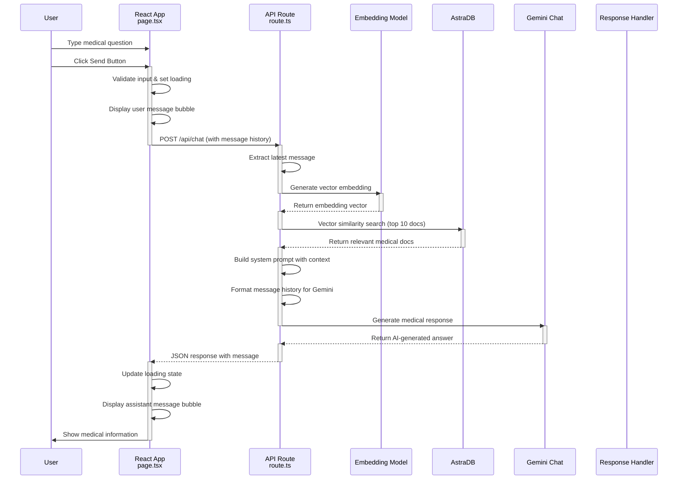
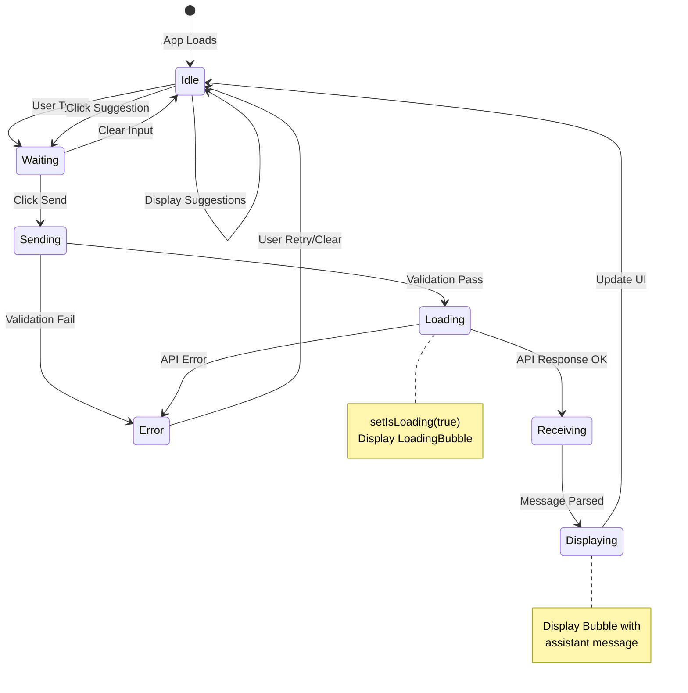
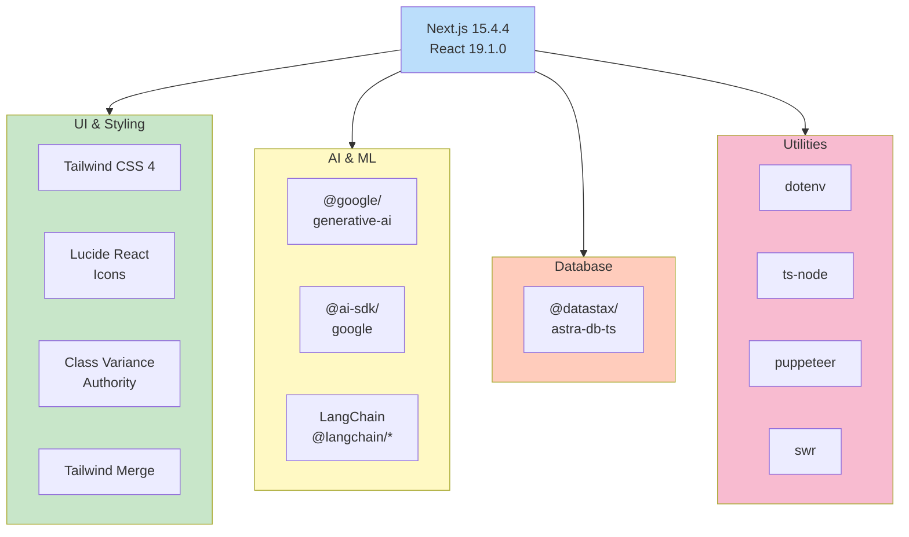

# 🏥 MEDIC - Medical Chatbot

An advanced AI-powered medical chatbot built with **Next.js**, **Google Generative AI (Gemini)**, and **AstraDB** vector database. This application provides evidence-based medical information and health education to users while maintaining the highest standards of accuracy and safety.

**Live Demo:** https://medicalchatbot-two.vercel.app

---

## ✨ Features

- **🤖 Intelligent Medical Assistant**: Powered by Google's Gemini 2.5 Flash model
- **🔍 Vector-Based Context Retrieval**: Uses AstraDB vector database for semantic search of medical knowledge
- **💬 Real-time Chat Interface**: Responsive, user-friendly chat UI built with React
- **📚 Medical Knowledge Base**: Retrieves relevant medical context for informed responses
- **🎨 Modern UI/UX**: Beautiful gradient design with Tailwind CSS
- **🔐 Privacy-Focused**: No personal health data storage or tracking
- **⚡ Fast & Scalable**: Deployed on Vercel with serverless architecture
- **📱 Responsive Design**: Works seamlessly on desktop, tablet, and mobile devices

---

## 🛠️ Tech Stack

### Frontend
- **Next.js 15.4.4** - React framework with App Router
- **React 19.1.0** - UI library
- **TypeScript** - Type-safe development
- **Tailwind CSS 4** - Utility-first styling
- **Lucide React** - Icon library

### Backend
- **Next.js API Routes** - Serverless backend functions
- **Google Generative AI API** - Gemini model for chat
- **@google/generative-ai** - Google AI SDK

### Database
- **DataStax AstraDB** - Vector database for semantic search
- **Vector Embeddings** - text-embedding-004 model

### Utilities
- **ts-node** - TypeScript execution
- **dotenv** - Environment variable management
- **Puppeteer** - Browser automation (for data seeding)
- **SWR** - Data fetching library

---

## 📊 Architecture Diagrams

### 1️⃣ High-Level System Architecture



---

### 2️⃣ Low-Level Component Architecture



---

### 3️⃣ User Interaction & Message Flow



---

### 4️⃣ Data Flow Pipeline

```mermaid
graph LR
    Input["User Input<br/>Medical Question"]
    
    subgraph Processing["Processing Pipeline"]
        Valid["Input Validation"]
        Embed["Vector Embedding<br/>text-embedding-004"]
        Search["Vector Search<br/>Similarity Match"]
        Context["Context Assembly<br/>Relevant Docs"]
        Format["Message Formatting<br/>Gemini Format"]
        Prompt["System Prompt<br/>Medical Expert Role"]
    end
    
    subgraph Generation["Response Generation"]
        Chat["Gemini 2.5 Flash<br/>Model Inference"]
        Parse["Response Parsing<br/>Extract Text"]
        Safe["Safety Filter<br/>Medical Guidelines"]
    end
    
    Output["Medical Response<br/>with Citations"]
    
    Input --> Valid
    Valid --> Embed
    Embed --> Search
    Search --> Context
    Context --> Format
    Format --> Prompt
    Prompt --> Chat
    Chat --> Parse
    Parse --> Safe
    Safe --> Output
    
    style Input fill:#c8e6c9
    style Processing fill:#e1f5fe
    style Generation fill:#fff9c4
    style Output fill:#ffccbc
```



---

### 5️⃣ Component State Management



---

### 6️⃣ Project Dependencies



---

## 🚀 Getting Started

### Prerequisites
- Node.js 18+ 
- npm or yarn package manager
- Environment variables configured (see below)

### Installation

1. **Clone the repository**
   ```bash
   git clone https://github.com/SARBAJITK805/medicalchatbot.git
   cd medicalchatbot
   ```

2. **Install dependencies**
   ```bash
   npm install
   # or
   yarn install
   ```

3. **Configure environment variables**
   
   Create a `.env.local` file in the root directory:
   ```env
   # Google Generative AI
   GEMINI_API_KEY=your_google_ai_api_key
   
   # AstraDB Configuration
   ASTRA_DB_ENDPOINT=your_astra_db_endpoint
   ASTRA_DB_NAMESPACE=your_namespace
   ASTRA_DB_COLLECTION=your_collection_name
   ASTRA_DB_APPLICATION_TOKEN=your_astra_db_token
   ```

   **Getting API Keys:**
   - **Google AI**: Visit [Google AI Studio](https://aistudio.google.com/apikey)
   - **AstraDB**: Sign up at [DataStax Astra](https://astra.datastax.com/)

4. **Start the development server**
   ```bash
   npm run dev
   # or
   yarn dev
   ```

5. **Open your browser**
   
   Navigate to [http://localhost:3000](http://localhost:3000)

---

## 📁 Project Structure

```
medicalchatbot/
├── app/
│   ├── api/
│   │   └── chat/
│   │       └── route.ts              # Chat API endpoint
│   ├── components/
│   │   ├── Bubble.tsx                # Message display component
│   │   ├── LoadingBubble.tsx          # Loading state component
│   │   ├── PromptSuggestionButton.tsx # Suggestion button
│   │   └── PromptSuggestionRow.tsx    # Suggestion row container
│   ├── layout.tsx                     # Root layout
│   ├── page.tsx                       # Main chat page
│   ├── favicon.ico                    # App icon
│   └── globals.css                    # Global styles
├── lib/
│   └── utils.ts                       # Utility functions
├── scripts/
│   └── loadDb.ts                      # Database seeding script
├── public/                            # Static assets
├── package.json                       # Dependencies
├── tsconfig.json                      # TypeScript config
├── next.config.ts                     # Next.js config
├── tailwind.config.ts                 # Tailwind CSS config
├── postcss.config.mjs                 # PostCSS config
├── components.json                    # UI components config
├── eslint.config.mjs                  # ESLint rules
├── .env.local                         # Environment variables (create this)
└── README.md                          # This file
```

---

## 🔄 How It Works

### Step 1: User Input
- User enters a medical question in the chat input field
- Frontend validates that the input is not empty
- Message is prepared with a unique ID and timestamp

### Step 2: Send to Backend
- React makes an HTTP POST request to `/api/chat`
- Request includes the complete message history for context
- Loading state is activated to show the user a waiting indicator

### Step 3: Generate Embedding
- The backend extracts the latest user message
- Uses Google's `text-embedding-004` model to convert the question into a vector
- This vector represents the semantic meaning of the question in numerical form

### Step 4: Retrieve Medical Context
- Vector similarity search is performed in AstraDB
- System finds the top 10 most relevant medical documents
- These documents match the semantic meaning of the user's question
- Context is compiled and prepared for the AI model

### Step 5: Generate Response
- The system constructs a comprehensive prompt that includes:
  - Medical system instructions (be accurate, cite sources, etc.)
  - Retrieved medical context
  - Complete message history for conversational context
- Gemini 2.5 Flash model generates a medically accurate response
- Response is parsed and returned to the frontend
- Frontend displays the response and updates the UI

---

## 📊 API Endpoints

### POST `/api/chat`

Sends a user message and returns an AI-generated medical response.

**Request:**
```json
{
  "messages": [
    {
      "id": "msg-1",
      "content": "What are the symptoms of diabetes?",
      "role": "user"
    }
  ]
}
```

**Response:**
```json
{
  "message": "Diabetes is a metabolic disorder characterized by elevated blood sugar levels. Key symptoms include increased thirst, frequent urination, fatigue, blurred vision, and unexplained weight loss. There are two main types: Type 1 and Type 2...",
  "success": true
}
```

**Error Response:**
```json
{
  "error": "Internal server error",
  "success": false
}
```

**Status Codes:**
- `200 OK` - Successful response
- `500 Internal Server Error` - Server-side error

---

## 🎯 Component Details

### `app/page.tsx` - Main Chat Interface

**Responsibilities:**
- Manages chat state (messages array, input text, loading state)
- Handles message sending and API communication
- Renders UI components (Bubble, LoadingBubble, PromptSuggestion)
- Manages user input validation and error handling

**Key State:**
```typescript
const [messages, setMessages] = useState<Message[]>([]);
const [input, setInput] = useState("");
const [isLoading, setIsLoading] = useState(false);
```

### `app/components/Bubble.tsx` - Message Display

**Responsibilities:**
- Displays individual messages in chat bubbles
- Different styling for user vs. assistant messages
- Shows MEDIC branding for assistant responses
- Handles text wrapping and formatting

**Props:**
```typescript
interface Message {
  id: string;
  content: string;
  role: "user" | "assistant";
}
```

### `app/components/LoadingBubble.tsx` - Loading State

**Responsibilities:**
- Displays animated loading indicator
- Shows while waiting for API response
- Provides visual feedback to user

### `app/components/PromptSuggestionRow.tsx` - Initial Suggestions

**Responsibilities:**
- Displays pre-defined medical questions
- Helps users get started if they're unsure what to ask
- Clickable suggestions that auto-fill the message input

**Suggestions:**
- Describe the symptoms and possible causes of a persistent cough
- Explain the steps involved in diagnosing diabetes
- List common treatments for high blood pressure
- Summarize the differences between viral and bacterial infections
- Discuss the importance of vaccination in public health

### `app/components/PromptSuggestionButton.tsx` - Suggestion Button

**Responsibilities:**
- Individual clickable button for each suggestion
- Triggers message sending with suggestion text
- Styled for visual consistency

### `app/api/chat/route.ts` - Chat API Handler

**Responsibilities:**
- Handles POST requests from frontend
- Manages vector embeddings generation
- Performs AstraDB vector similarity searches
- Interacts with Google Generative AI (Gemini)
- Formats and returns responses

**Key Flow:**
1. Extract latest message from request
2. Generate embedding vector
3. Search AstraDB for relevant documents
4. Build system prompt with context
5. Call Gemini model with full conversation history
6. Return formatted response

---

## 🔒 Safety & Guidelines

This application follows strict medical and safety guidelines:

### ⚠️ Important Disclaimer

**This AI assistant provides general medical information for educational purposes only.**

- **Not a Medical Professional**: This is not a substitute for professional medical advice, diagnosis, or treatment
- **No Diagnoses**: Cannot provide medical diagnoses
- **No Treatment Plans**: Cannot recommend specific treatment plans for individuals
- **Emergency Help**: For medical emergencies, call emergency services (911 in USA)
- **Always Consult**: Users must consult qualified healthcare professionals for personal medical concerns
- **No Personal Health Data**: Does not store or retain personal health information

### Safety Features

The system is designed with multiple safety measures:

1. **System Prompt Enforcement**
   - Instructs model to provide evidence-based information
   - Requires citations to reputable sources
   - Encourages professional consultation

2. **Source References**
   - Cites WHO, CDC, NICE guidelines
   - References peer-reviewed journals
   - Uses UpToDate and similar databases

3. **Limitation Statements**
   - Clearly states uncertainties
   - Acknowledges gaps in knowledge
   - Recommends further research when needed

4. **Privacy Protection**
   - Doesn't request personal health information
   - Doesn't store conversation history permanently
   - Respects user confidentiality

5. **Responsible Language**
   - Avoids making promises or guarantees
   - Uses qualified language ("may," "can," "research suggests")
   - Emphasizes need for professional consultation

---

## 🚢 Deployment

### Vercel Deployment (Recommended)

1. **Push to GitHub**
   ```bash
   git push origin main
   ```

2. **Connect to Vercel**
   - Go to [Vercel Dashboard](https://vercel.com/dashboard)
   - Click "New Project"
   - Select your GitHub repository
   - Import the project

3. **Configure Environment Variables**
   - In Vercel project settings → Environment Variables
   - Add all variables from `.env.local`:
     - `GEMINI_API_KEY`
     - `ASTRA_DB_ENDPOINT`
     - `ASTRA_DB_NAMESPACE`
     - `ASTRA_DB_COLLECTION`
     - `ASTRA_DB_APPLICATION_TOKEN`

4. **Deploy**
   - Click "Deploy"
   - Vercel automatically builds and deploys
   - Your app will be live at `your-project.vercel.app`

### Manual Build & Deployment

```bash
# Build the project
npm run build

# Start production server
npm start
```

Access the app at `http://localhost:3000`

### Docker Deployment

Create a `Dockerfile`:
```dockerfile
FROM node:18-alpine

WORKDIR /app

COPY package*.json ./
RUN npm ci --only=production

COPY .next .next
COPY public public

EXPOSE 3000

CMD ["npm", "start"]
```

Build and run:
```bash
docker build -t medicalchatbot .
docker run -p 3000:3000 -e GEMINI_API_KEY=your_key medicalchatbot
```

---

## 📝 Available Scripts

```bash
# Start development server with hot reload
npm run dev

# Build for production
npm run build

# Start production server
npm start

# Run ESLint to check code quality
npm run lint

# Seed database with medical knowledge
npm run seed
```

---

## 🔧 Configuration Files

### `tsconfig.json`
- TypeScript compiler options
- Path aliases configuration
- Module resolution settings
- Strict type checking

### `tailwind.config.ts`
- Tailwind CSS customization
- Color schemes and palettes
- Typography settings
- Spacing and sizing

### `next.config.ts`
- Next.js build configuration
- API route handling
- Image optimization settings

### `postcss.config.mjs`
- PostCSS plugins configuration
- CSS processing pipeline

### `components.json`
- UI component library configuration
- Component aliases and paths

### `.env.local` (Create This File)
```env
GEMINI_API_KEY=your_key_here
ASTRA_DB_ENDPOINT=https://your-endpoint
ASTRA_DB_NAMESPACE=your_namespace
ASTRA_DB_COLLECTION=medical_docs
ASTRA_DB_APPLICATION_TOKEN=your_token
```

⚠️ **Important**: Never commit `.env.local` to version control. Use `.env.local.example` for reference.

---

## 📦 Key Dependencies Explained

### UI & Styling
- **Tailwind CSS 4**: Utility-first CSS framework for responsive design
- **Lucide React**: Icon library with 500+ icons
- **Class Variance Authority**: Type-safe CSS variant patterns
- **Tailwind Merge**: Utility merge for combining Tailwind classes

### AI & ML
- **@google/generative-ai**: Official Google AI SDK
- **@ai-sdk/google**: Vercel AI SDK integration for Google
- **@langchain/core & @langchain/community**: LLM orchestration libraries
- **langchain**: Complete LangChain toolkit

### Database
- **@datastax/astra-db-ts**: TypeScript client for AstraDB vector database

### Development
- **TypeScript**: Adds static typing to JavaScript
- **ts-node**: Run TypeScript files directly
- **Puppeteer**: Browser automation for data scraping
- **dotenv**: Environment variable management

---

## 🔐 Security Best Practices

### 1. **API Keys**
- Never commit `.env.local` to version control
- Use Vercel secrets for production deployment
- Rotate API keys regularly
- Use environment-specific keys

### 2. **Input Validation**
- Validate all user inputs on the frontend and backend
- Sanitize inputs to prevent injection attacks
- Implement rate limiting for API endpoints

### 3. **Data Privacy**
- Use HTTPS for all communications
- Don't store personal health information
- Clear conversation history on session end
- Comply with HIPAA if handling patient data

### 4. **API Security**
- Implement proper error handling
- Don't expose sensitive error messages
- Use CORS properly
- Implement request validation

### 5. **Database Security**
- Use strong authentication tokens
- Implement proper access controls
- Encrypt sensitive data
- Regular backups

---

## 🐛 Troubleshooting

### Issue: "Missing required environment variables"

**Solution:**
- Check that all 5 environment variables are set in `.env.local`
- Verify they're in the correct format
- Restart the development server after adding variables

### Issue: "Vector search returning no results"

**Solution:**
- Ensure the AstraDB collection is populated with documents
- Run the seed script: `npm run seed`
- Check that the collection name matches in environment variables
- Verify vector embedding dimension matches (1536 for embedding-004)

### Issue: "API rate limiting errors"

**Solution:**
- Implement exponential backoff in your requests
- Check Google AI API quota limits
- Use a caching strategy for frequent queries
- Consider using SWR for data fetching optimization

### Issue: "CORS errors in browser"

**Solution:**
- Ensure API routes are in `/app/api` directory
- Check Next.js configuration for CORS settings
- Verify request headers are correct
- Test with Postman to isolate frontend vs backend

### Issue: "Build failures with TypeScript"

**Solution:**
- Run `npm run lint` to check for errors
- Clear `.next` directory: `rm -rf .next`
- Reinstall dependencies: `rm -rf node_modules && npm install`
- Check TypeScript strict mode settings

---

## 📈 Performance Optimization

### Frontend Optimization

1. **Code Splitting**
   - Next.js automatically splits code by route
   - Use dynamic imports for large components

2. **Image Optimization**
   - Use Next.js Image component
   - Optimize SVG files
   - Compress PNG/JPEG files

3. **CSS Optimization**
   - Tailwind CSS purges unused styles
   - Use CSS modules for component scoping
   - Minimize global CSS

### Backend Optimization

1. **Caching Strategy**
   - Cache embedding vectors
   - Use SWR for client-side data fetching
   - Implement server-side response caching

2. **Database Optimization**
   - Use vector indexing in AstraDB
   - Optimize similarity search parameters
   - Monitor query performance

3. **API Optimization**
   - Implement request compression
   - Use streaming for large responses
   - Optimize JSON payload size

---

## 🗺️ Roadmap & Future Enhancements

### Planned Features
- [ ] User authentication and accounts
- [ ] Conversation history persistence
- [ ] Multi-language support
- [ ] Voice input/output capability
- [ ] Mobile app (React Native)
- [ ] Advanced medical literature search
- [ ] Integration with healthcare APIs
- [ ] Real-time collaboration features
- [ ] Advanced analytics and insights
- [ ] Customizable medical specialty filters

### Technical Improvements
- [ ] Implement WebSockets for real-time updates
- [ ] Add message encryption
- [ ] Implement advanced caching strategies
- [ ] Add comprehensive logging and monitoring
- [ ] Create GraphQL API alternative
- [ ] Implement full-text search capabilities
- [ ] Add batch processing for bulk queries
- [ ] Implement request queuing system

---

## 🤝 Contributing

Contributions are welcome! Please follow these guidelines:

### Development Guidelines

1. **Fork the repository**
   ```bash
   git clone https://github.com/YOUR_USERNAME/medicalchatbot.git
   cd medicalchatbot
   ```

2. **Create a feature branch**
   ```bash
   git checkout -b feature/amazing-feature
   ```

3. **Commit your changes**
   ```bash
   git commit -m 'Add amazing feature'
   ```

4. **Push to the branch**
   ```bash
   git push origin feature/amazing-feature
   ```

5. **Open a Pull Request**
   - Provide clear description of changes
   - Link related issues
   - Include screenshots if UI changes

### Code Standards
- Use TypeScript for all new code
- Follow ESLint rules
- Write meaningful commit messages
- Add comments for complex logic
- Test before submitting PR

### Bug Reports
- Use GitHub Issues to report bugs
- Provide reproduction steps
- Include error messages and logs
- Specify your environment (OS, Node version, etc.)

---

## 📄 License

This project is open source and available under the MIT License.

```
MIT License

Permission is hereby granted, free of charge, to any person obtaining a copy
of this software and associated documentation files (the "Software"), to deal
in the Software without restriction, including without limitation the rights
to use, copy, modify, merge, publish, distribute, sublicense, and/or sell
copies of the Software.
```

---

## 👤 Author

**SARBAJITK805**
- GitHub: [@SARBAJITK805](https://github.com/SARBAJITK805)
- Project Repository: [medicalchatbot](https://github.com/SARBAJITK805/medicalchatbot)

---

## 🙏 Acknowledgments

- **Google** for the Generative AI API
- **DataStax** for AstraDB vector database
- **Vercel** for excellent hosting and deployment platform
- **OpenAI, Anthropic, and Google** for advancing AI research
- The open-source and medical communities for inspiration

---

## ❓ FAQ

### Q: Is this a real medical diagnosis tool?
**A:** No. This is an educational tool for learning about medical topics. It cannot replace professional medical diagnosis or treatment. Always consult with qualified healthcare professionals for personal medical concerns.

### Q: Where is my medical data stored?
**A:** User questions are sent to Google's API for processing but are not permanently stored. Medical documents in the knowledge base are stored in AstraDB. Conversation history is not saved after the session ends.

### Q: Can I use this for treating patients?
**A:** No. This tool is strictly for educational purposes and general medical information. Healthcare professionals should not rely on this for clinical decisions.

### Q: How accurate is the medical information?
**A:** The tool uses evidence-based information from reputable sources (WHO, CDC, NICE), but it's not perfect. All information should be verified with healthcare professionals and current medical literature.

### Q: Does this tool provide personalized medical advice?
**A:** No. It provides general medical information only. It does not consider individual health conditions, medications, or allergies. Personalized advice must come from a healthcare professional who knows the patient's complete medical history.

### Q: How do I report a bug or issue?
**A:** Please open an issue on [GitHub Issues](https://github.com/SARBAJITK805/medicalchatbot/issues) with detailed information about the bug, including steps to reproduce it.

### Q: Can I integrate this into my healthcare application?
**A:** While the code is open source, integrating it into a healthcare application requires careful consideration of legal and regulatory requirements (HIPAA, GDPR, etc.). Please consult with legal experts.

### Q: How can I contribute to this project?
**A:** Fork the repository, make your changes, and submit a pull request. Please ensure your code follows the existing style and includes appropriate tests.

### Q: Is there an API I can use?
**A:** The project includes a `/api/chat` endpoint that you can use. See the API Endpoints section for details on request/response format.

### Q: How do I update the medical knowledge base?
**A:** Run the `npm run seed` script with your medical documents. The script processes documents and stores them as vectors in AstraDB.

### Q: What happens if the API is down?
**A:** The user will see an error message. Implement retry logic and fallback mechanisms for production applications.

### Q: Can I use this commercially?
**A:** The project is under MIT License, which allows commercial use, but with certain restrictions. Please review the license terms carefully.

---

## 📞 Support

### Getting Help

- **Documentation**: Read this README and the [Next.js Documentation](https://nextjs.org/docs)
- **Issues**: Check [GitHub Issues](https://github.com/SARBAJITK805/medicalchatbot/issues)
- **Discussions**: Use [GitHub Discussions](https://github.com/SARBAJITK805/medicalchatbot/discussions)
- **API Docs**: [Google AI API](https://ai.google.dev/), [AstraDB Docs](https://docs.datastax.com/en/astra/astra-db-vector/)

### Reporting Issues

When reporting issues, please provide:
1. Description of the issue
2. Steps to reproduce
3. Expected vs actual behavior
4. Your environment (Node version, OS, etc.)
5. Error messages and logs
6. Screenshots if relevant

---

## 📊 Project Statistics

- **Created**: July 26, 2025
- **Last Updated**: May 11, 2026
- **Version**: 0.1.0
- **License**: MIT
- **Language**: TypeScript
- **Repository**: https://github.com/SARBAJITK805/medicalchatbot
- **Live Demo**: https://medicalchatbot-two.vercel.app

---

## 🎓 Learning Resources

### Next.js
- [Next.js Documentation](https://nextjs.org/docs) - Official docs and guides
- [Next.js Tutorial](https://nextjs.org/learn) - Interactive learning
- [App Router Guide](https://nextjs.org/docs/app) - New App Router features

### React
- [React Documentation](https://react.dev) - Official React docs
- [React Hooks Guide](https://react.dev/reference/react) - Hooks API reference

### TypeScript
- [TypeScript Handbook](https://www.typescriptlang.org/docs/) - Official documentation
- [TypeScript Playground](https://www.typescriptlang.org/play) - Try TypeScript online

### Tailwind CSS
- [Tailwind Documentation](https://tailwindcss.com/docs) - Complete reference
- [Tailwind UI](https://tailwindui.com/) - Pre-built components

### AI & ML
- [Google Generative AI](https://ai.google.dev/) - Official API docs
- [LangChain Documentation](https://js.langchain.com/) - LangChain JS docs

### Database
- [AstraDB Documentation](https://docs.datastax.com/en/astra/astra-db-vector/) - Vector DB guide
- [Vector Search Guide](https://docs.datastax.com/en/astra/astra-db-vector/search) - Search examples

---

**Made with ❤️ by SARBAJITK805**

**Star this repository if you find it helpful!** ⭐
